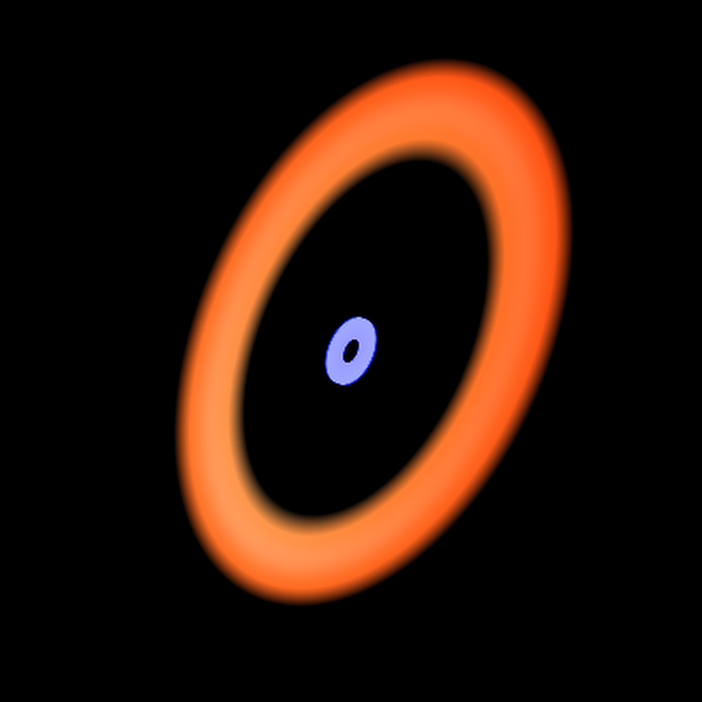
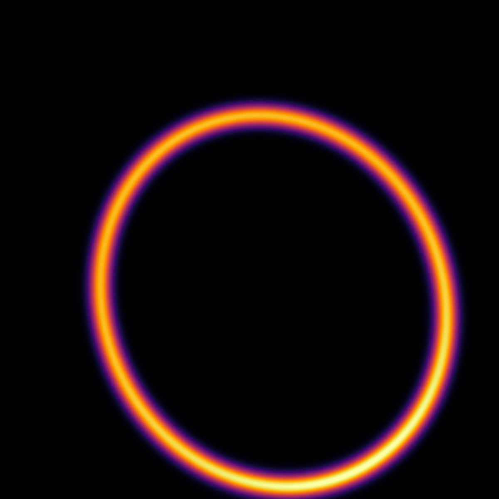
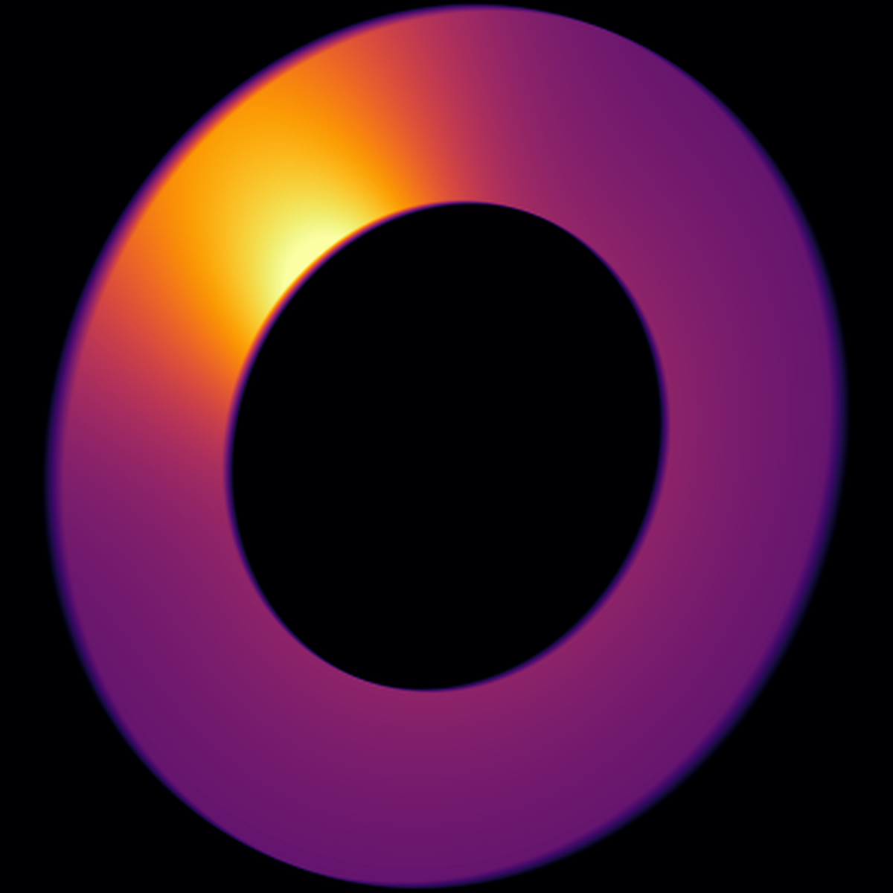
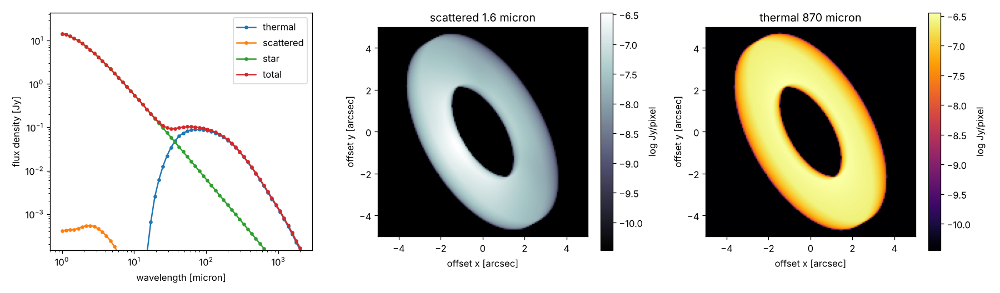
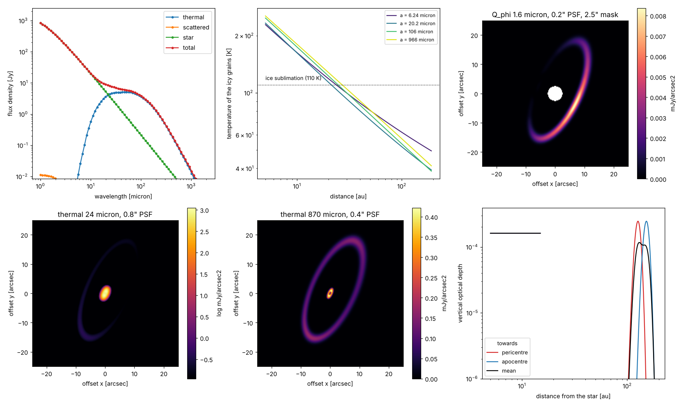

# DMS – Debris disks around Main-sequence Stars

<p align="center">
  
  
  
  
</p>
<p align="center"><sub>Computed with DMS: a narrow ring in scattered light (1.6 µm), two belts at
24/70/870 µm, apocentre glow of an eccentric ring (870 µm) and a ring with a clump (870 µm).</sub></p>

DMS computes what an optically thin debris disk looks like: its spectral energy distribution
(SED), thermal emission maps, scattered-light images and linear-polarisation images
(Stokes Q, U, Q_φ, U_φ), together with the fractional luminosity f_d = L_d/L* and the optical
depth. You describe the star, the dust and the geometry of one or more belts (which may be
eccentric); DMS computes the grain temperatures, the optical properties of the grains and the
emission of every volume element, and adds them up for any inclination and position angle.

The core is written in Fortran (free-form `.f90` source) with OpenMP. It runs from the command
line with an input file, or from Python (`import dms`), where a model is a few lines of code and
the results come back as NumPy arrays.

DMS was introduced in Kim et al. (2018, A&A 618, A38). A reference manual with the physics and a
detailed user guide is in [docs/manual/dms_manual.pdf](docs/manual/dms_manual.pdf).

## Example 1: a first model in Python

A ring of dust between 50 and 100 au around a Sun-like star at 20 pc, seen at 60° inclination:

```python
import dms

model = dms.Model(
    star={"teff": 5800, "radius": 1.0, "mass": 1.0, "distance": 20},       # K, R_sun, M_sun, pc
    disk={"r_in": 50, "r_out": 100, "dust_mass": 1e-8,                      # au, M_sun
          "inclination": 60, "position_angle": 30},                         # degrees
    dust={"n_components": 1, "optical_data": "astrosilicate_draine03_862",
          "bulk_density": 3.5, "a_min": 1, "a_max": 1000, "q": 3.5},        # g/cm^3, micron
)

# SED from 1 to 2000 micron
sed_model = model.copy().update(run={"mode": "sed"},
                                wavelengths={"lambda_min": 1, "lambda_max": 2000, "n_lambda": 60})
sed = sed_model.run()
print(sed.f_d)                       # fractional luminosity, 8.1e-05
sed.sed["thermal"]                   # flux density [Jy] at sed.wavelength [micron]

# images at 1.6 micron (scattered light) and 870 micron (thermal emission)
img_model = model.copy().update(run={"mode": "image"}, wavelengths={"lambda": [1.6, 870]},
                                image={"n_pixels": 151})
img = img_model.run()
img.image("scattered")[0]            # 151 x 151 array [Jy/pixel]
img.image("thermal")[1]

# quick-look plots (matplotlib)
import matplotlib.pyplot as plt
fig, ax = plt.subplots(1, 2, figsize=(10, 4))
dms.plot.sed(sed, ax=ax[0])
dms.plot.image(img, "thermal", il=1, ax=ax[1])
plt.show()
```

This takes about ten seconds. The complete script is
[examples/quickstart.py](examples/quickstart.py) (`python examples/quickstart.py`); it makes
this figure:

<p align="center"></p>

Every parameter has the same name and unit as in the input files
([docs/input_reference.md](docs/input_reference.md)); anything you do not set keeps its default.
To change a model, update it and run it again:

```python
img_model.update(disk={"eccentricity": 0.2, "omega": 45})   # make the ring eccentric
img = img_model.run()
```

## Example 2: two belts of icy grains, observed

A warm inner belt (5–15 au) and a cold, eccentric outer belt (Gaussian, peak at 140 au, e = 0.12)
around an A star at 7.7 pc. The grains are a mixture of astronomical silicate and water ice; where
they are warmer than 110 K the ice sublimates and porous silicate remains. Grains are removed by
radiation pressure if they are unbound when released at pericentre. The model is observed in
polarised light with a coronagraph mask and in thermal emission with a PSF:

```python
system = dms.Model(
    star={"teff": 8590, "radius": 1.84, "mass": 1.92, "distance": 7.7},
    disk={"n_belts": 2,                                   # one value per belt in every list
          "density_law": ["powerlaw", "gaussian"], "alpha": [1, 0], "mu": [0, 140], "sigma": [0, 8],
          "r_in": [5, 110], "r_out": [15, 170], "eccentricity": [0, 0.12], "omega": [0, 40],
          "belt_mass_fraction": [0.02, 0.98], "vertical": "gaussian", "h_over_r": 0.03,
          "dust_mass": 1e-8, "inclination": 66, "position_angle": 156},
    dust={"n_components": 2,
          "optical_data": ["kim2019/ice_astrosilicate_MG/Sil50cice50",     # 50 % silicate, 50 % ice
                           "kim2019/porous_astrosilicate/as50vac50"],      # residue after sublimation
          "bulk_density": [1.95, 1.75], "abundance": [100, 0],
          "sublimation": True, "t_sublimation": [110, -1], "sublimation_residue": [2, 0],
          "a_min": 1, "a_max": 1000, "q": 3.5, "blowout_release": "pericentre"},
)

sed = system.copy().update(run={"mode": "sed"},
                           wavelengths={"lambda_min": 1, "lambda_max": 2000, "n_lambda": 80}).run()
pol = system.copy().update(run={"mode": "image", "emission": "polarisation"}, wavelengths={"lambda": [1.6]},
                           image={"n_pixels": 201, "psf": "gaussian", "psf_fwhm": 0.2,
                                  "mask_radius": 2.5}).run()           # arcsec
th = system.copy().update(run={"mode": "image", "emission": "thermal"}, wavelengths={"lambda": [24, 870]},
                          image={"n_pixels": 201, "psf": "gaussian", "psf_fwhm": [0.8, 0.4]}).run()

pol.image("Qphi", observed=True, unit="mJy/arcsec2")   # convolved and masked Q_phi
sed.temperature["T"]                                   # grain temperatures [distance, component, size]
sed.tau_profile["pericentre"]                          # vertical optical depth towards pericentre
sed.blowout_beta                                       # blow-out threshold: (0.44, 0.5)
```

The complete script, [examples/two_belts_observed.py](examples/two_belts_observed.py), takes about
two minutes and makes this figure: the SED, the temperatures of the icy grains (grains smaller
than about 6 µm are blown out; the ice of the others sublimates inside 21–27 au, depending on
their size), Q_φ at 1.6 µm, the thermal images at 24 and 870 µm, and the vertical optical depth
of both belts.

<p align="center"></p>

## Installation

You need a Fortran compiler with OpenMP (gfortran ≥ 10) and, for Python, NumPy.

```bash
git clone https://github.com/minjaegasparkim/dms.git
cd dms
make                                   # command-line program bin/dms
make python                            # Python extension (numpy.f2py)
pip install -e python                  # optional: "import dms" from any directory
make test                              # optional: test suite, about one minute
```

- **macOS:** `brew install gcc` provides gfortran.
- **Linux (Debian/Ubuntu):** `sudo apt install gfortran`.
- **Python ≥ 3.12:** `numpy.f2py` also needs `pip install meson ninja`.
- astropy (FITS files) and matplotlib (plots) are optional; pytest is needed for `make test`.
- Intel ifx: `make FC=ifx OMP=-qopenmp` (not tested).

The code uses a few Fortran 2003/2008 features (`error stop`, `open(newunit=)`,
`execute_command_line`, `block`) and is compiled with `-std=f2008`.

## The command-line program

```bash
bin/dms examples/debris_ring.nml       # results go to results/
python3 tools/quicklook.py results ring -o ring.png
bin/dms                                # without an input file: interactive questions
```

The input file is a Fortran namelist with the groups `&run`, `&star`, `&disk`, `&image`,
`&wavelengths`, `&dust` and `&scattering`. Outputs are FITS and/or ASCII files: images, radial
profiles, the SED, temperatures, grain numbers and the vertical optical depth
([docs/outputs.md](docs/outputs.md)). In Python, `model.write("model.nml")` writes the input file
of a model, and `dms.Model.from_file("model.nml")` reads one.

## Examples

| file | what it shows |
|---|---|
| [examples/quickstart.py](examples/quickstart.py) | Example 1 above: a first model in Python |
| [examples/two_belts_observed.py](examples/two_belts_observed.py) | Example 2 above: two belts, icy grains with sublimation, PSF and coronagraph mask |
| [examples/debris_ring.nml](examples/debris_ring.nml) | a ring around a solar-type star: images and SED |
| [examples/eccentric_ring.nml](examples/eccentric_ring.nml) | an eccentric ring (e = 0.3): pericentre and apocentre glow |
| [examples/two_belts.nml](examples/two_belts.nml) | a warm inner belt and an eccentric cold outer belt |
| [examples/edge_on_disk.nml](examples/edge_on_disk.nml) | an edge-on disk in scattered light with a PSF and a coronagraph mask |
| [examples/polarisation_hg.nml](examples/polarisation_hg.nml) | polarisation with a two-component Henyey–Greenstein phase function |
| [examples/sublimation_ice.nml](examples/sublimation_ice.nml) | ice–silicate grains that lose their ice inside the sublimation radius |
| [examples/clump_user_density.nml](examples/clump_user_density.nml) | a user-defined density: a ring with a clump |

## Features

- Several belts (rings), each with its own radial law (power law, Ertel peak, Gaussian, smooth
  broken power law, or **user-defined**), radii, eccentricity and argument of pericentre
- Eccentric belts built from confocal orbits (set e and ω; R_in and R_out are semi-major axes)
- Vertical structure: a wedge (fixed opening angle) or a Gaussian profile (h/r)
- Inclination and position angle
- Dust: several components, effective-medium mixing (Maxwell-Garnett, Bruggeman, Lichtenecker,
  Looyenga), temperature-dependent optical constants, sublimation (a component either vanishes
  or turns into another one), removal of grains blown out by radiation pressure (β ≥ 1/2, or
  the threshold for release at pericentre or apocentre of eccentric belts, or any value)
- Grain sizes: one size, a power law, or read from a file
- Grain shape: homogeneous spheres (Mie) or a distribution of hollow spheres (DHS, Min et al. 2005)
- Phase function: Mie theory, Henyey–Greenstein, or two-component Henyey–Greenstein
- Star: black body, spectrum from a file, or a model-atmosphere grid (PHOENIX, Castelli–Kurucz)
- Images with adaptive refinement of the volume elements where the temperature or the density
  changes quickly (near the star, narrow belts, forward scattering)
- Simulated observations: Gaussian or diffraction-limited PSF, coronagraph mask, images in
  Jy/pixel, mJy/arcsec² or Jy/arcsec²
- Scattered and polarised flux against scattering angle (whole disk), and optional 3-d cubes of
  the flux of every volume element with its scattering angle
- Python: single models in memory, many models from a queue folder in parallel (`dms.batch`),
  composite-grain optical constants with the emc code (`dms.emc`)

## Repository layout

```
src/                    Fortran source (modules, routines, main program dms.f90)
src/user_density.f90    edit this file to define your own density distribution
python/                 Python package "dms" and the f2py interface (dms_api.f90)
examples/               input files (namelists) and the Python quick start
data/optical_constants/ optical constants n, k (wavelength [micron], n, k)
data/stellar_models/    model-atmosphere grids (created with python -m dms.stellar)
docs/                   input reference, outputs, conventions, Python interface, manual
tests/                  test suite (pytest) and reference values of the examples
tools/                  quick-look plots, optical-constant plots
.github/workflows/      continuous integration (build and tests on every push)
```

At runtime, `results/` (output files) and `cache/` (saved optical properties) are created in
the working directory. You can change all directories in the input file (`&run`).

## Documentation

- [docs/manual/dms_manual.pdf](docs/manual/dms_manual.pdf): reference manual and user guide
  (physics, numerical methods and use of the code; LaTeX source in the same folder)
- [docs/python.md](docs/python.md): the Python interface
- [docs/input_reference.md](docs/input_reference.md): every input parameter, with units and defaults
- [docs/outputs.md](docs/outputs.md): output files and units
- [docs/conventions.md](docs/conventions.md): coordinate frames, eccentric belts, polarisation signs
- [docs/manual/cover/](docs/manual/cover/): the images on the manual cover and the scripts that
  reproduce them
- [CHANGELOG.md](CHANGELOG.md): changes with respect to the 2019 version

## Tests

```bash
make test
```

The suite (`tests/`, about one minute) checks energy conservation, image against SED integration,
polarisation in limits with known answers, geometry, blow-out, input and error handling, runs the
Python quick start, and compares all examples with stored reference values. GitHub Actions runs
it on every push.

## Citing

If you use DMS, please cite Kim et al. (2018, A&A 618, A38). If you use the optical data in
`data/optical_constants/kim2019/`, please also cite Kim et al. (2019, A&A 629, A141) and the
references given there. See [CITATION.cff](CITATION.cff).

DMS uses the Mie routine miex (Wolf & Voshchinnikov 2004) and parts of the debris/modim code
(Ertel et al. 2011, 2012).

## License

The license has not been chosen yet. It must also cover the bundled miex routine
(`src/mie_routines.f90`, Wolf & Voshchinnikov 2004) and the third-party optical data.

## Contact

Minjae G. Kim. Bug reports and questions: please open an issue.

Thanks to Steve Ertel, Robert Brunngräber, Florian Kirchschlager, Sebastian Wolf and Thomas
Stuber for their help with the original version.
