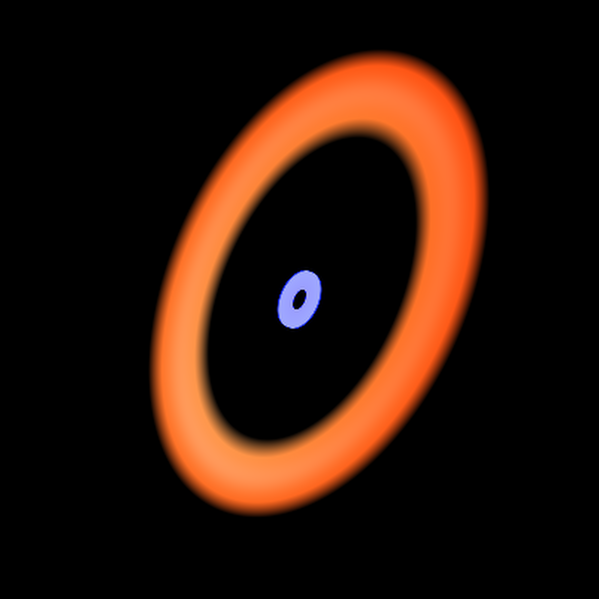
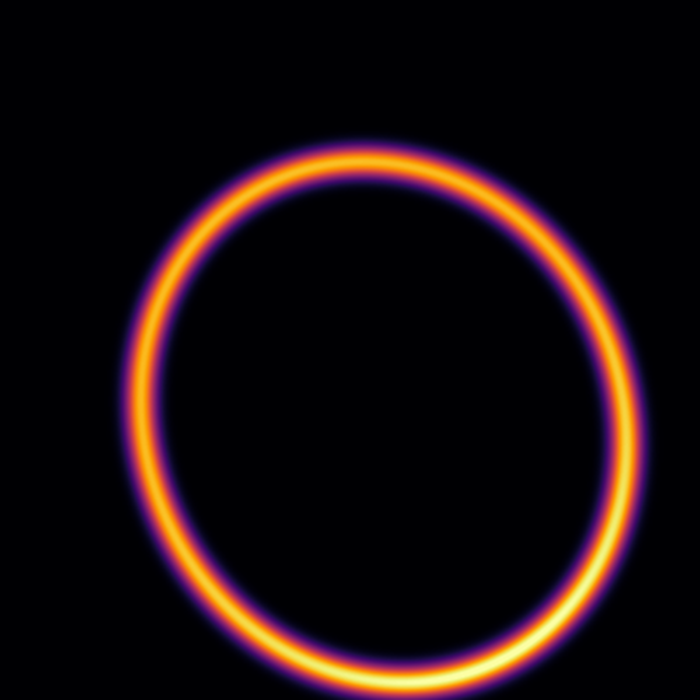
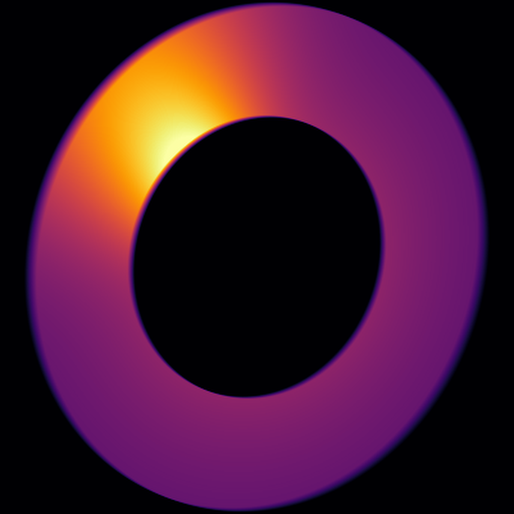
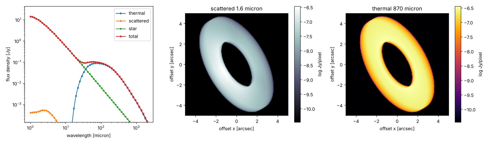
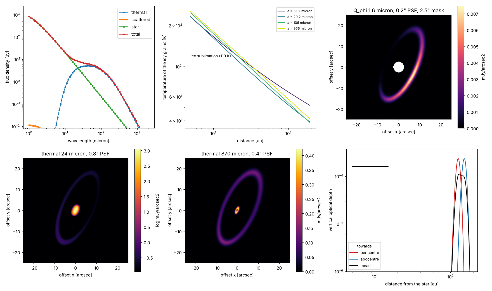
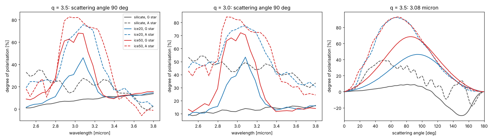

# DMS – Debris disks around Main-sequence Stars

<p align="center">
  
  
  
  
</p>
<p align="center"><sub>Computed with DMS: a narrow ring in scattered light (1.6 µm), two belts at
24/70/870 µm, apocentre glow of an eccentric ring (870 µm) and a ring with a clump (870 µm).</sub></p>

DMS computes what an optically thin debris disk looks like: its spectral energy distribution
(SED), thermal emission maps, scattered-light images and linear-polarisation images
(Stokes Q, U, Q_φ, U_φ), together with the fractional luminosity f_d = L_d/L* and the optical
depth. You describe the star, the dust and the geometry of one or more belts (which may be
eccentric); DMS computes the grain temperatures, the optical properties of the grains and the
emission of every volume element, and adds them up for any inclination and position angle.

The core is written in Fortran (free-form `.f90` source) with OpenMP. It runs from the command
line with an input file, or from Python (`import dms`), where a model is a few lines of code and
the results come back as NumPy arrays.

DMS was introduced in Kim et al. (2018, A&A 618, A38). A reference manual with the physics and a
detailed user guide is in [docs/manual/dms_manual.pdf](docs/manual/dms_manual.pdf).

## Prerequisites

Install these once, before you download DMS. On every system you need a Fortran compiler with
OpenMP (gfortran ≥ 10), a C compiler (installed together with gfortran on Linux; on macOS with
`xcode-select --install`), `make`, and Python ≥ 3.9.

| system | compiler and make |
|---|---|
| macOS | `xcode-select --install` (make, C compiler), then [Homebrew](https://brew.sh) and `brew install gcc` (gfortran with OpenMP) |
| Linux (Debian, Ubuntu) | `sudo apt install gfortran make python3 python3-pip python3-venv` |
| Linux (Fedora) | `sudo dnf install gcc-gfortran make python3 python3-pip` |
| Windows | install [WSL](https://learn.microsoft.com/windows/wsl/install) with Ubuntu and follow the Ubuntu line inside it |

Python: any distribution works (Anaconda, Miniforge, python.org, the system Python). A separate
environment keeps the versions consistent, e.g. `conda create -n dms python=3.12` and
`conda activate dms`. Then install the Python packages (NumPy ≥ 1.22, meson and ninja, which
`numpy.f2py` needs with Python ≥ 3.12, matplotlib, astropy, pytest and JupyterLab):

```bash
python3 -m pip install "numpy>=1.22" meson ninja matplotlib astropy pytest jupyterlab
```

(the same list is in `requirements.txt` of the repository: `python3 -m pip install -r requirements.txt`).

Use the same Python for `make python`, for Jupyter and for your scripts: the Python extension of
DMS is compiled for one Python version and only works with that one.

## Installation

```bash
git clone https://github.com/minjaegasparkim/dms.git
cd dms
python3 -m pip install -r requirements.txt     # the Python packages, if not installed yet
make                                           # the command-line program bin/dms
make python                                    # the Python extension (numpy.f2py)
make check                                     # checks everything above and says what is missing
make test                                      # optional: the test suite, about one minute
```

`make check` (`tools/check_setup.py`) lists each prerequisite as `ok` or `MISSING`, with the
command that fixes it. Common problems:

| message | what to do |
|---|---|
| `gfortran: command not found` | install the compiler (table above) |
| `Cannot use distutils backend with Python>=3.12`, then the build stops | `python3 -m pip install meson ninja`, then `make python` |
| `ImportError: the compiled DMS extension is missing` | run `make python` with the Python you use: `make python PYTHON=$(which python3)` |
| `module 'numpy' has no attribute ...` | NumPy is too old: `python3 -m pip install --upgrade numpy` |

`pip install -e python` makes `import dms` work from any directory; without it, scripts add the
`python/` folder of the repository to `sys.path` (the example notebooks do this themselves).
Intel ifx: `make FC=ifx OMP=-qopenmp` (not tested). The code uses a few Fortran 2003/2008 features
(`error stop`, `open(newunit=)`, `execute_command_line`, `block`) and is compiled with
`-std=f2008`.

## Example 0: getting started (Jupyter)

1. In a terminal, in the repository folder, start Jupyter: `jupyter lab`.
2. In the file browser on the left, open `examples/0_getting_started.ipynb`.
3. Run the cells one after the other with **Shift + Enter**.

The notebook runs the setup check with the Python of the notebook, imports DMS, computes the SED
of a small ring (f_d = 8.1e-05) and its image at 70 µm, and lists what to do if a step fails. It
takes less than a minute. Examples 1–3 are notebooks in the same folder; on GitHub they can be
read with their results without running them.

Without Jupyter, the command-line program can be tested with an input file:
`bin/dms examples/debris_ring.nml` (results in `results/`).

## Example 1: a first model

A ring of dust between 50 and 100 au around a Sun-like star at 20 pc, seen at 60° inclination:

```python
import dms

model = dms.Model(
    star={"teff": 5800, "radius": 1.0, "mass": 1.0, "distance": 20},       # K, R_sun, M_sun, pc
    disk={"r_in": 50, "r_out": 100, "dust_mass": 1e-8,                      # au, M_sun
          "inclination": 60, "position_angle": 30},                         # degrees
    dust={"n_components": 1, "optical_data": "astrosilicate_draine03_862",
          "bulk_density": 3.5, "a_min": 1, "a_max": 1000, "q": 3.5},        # g/cm^3, micron
)

# SED from 1 to 2000 micron
sed_model = model.copy().update(run={"mode": "sed"},
                                wavelengths={"lambda_min": 1, "lambda_max": 2000, "n_lambda": 60})
sed = sed_model.run()
print(sed.f_d)                       # fractional luminosity, 8.1e-05
sed.sed["thermal"]                   # flux density [Jy] at sed.wavelength [micron]

# images at 1.6 micron (scattered light) and 870 micron (thermal emission)
img_model = model.copy().update(run={"mode": "image"}, wavelengths={"lambda": [1.6, 870]},
                                image={"n_pixels": 151})
img = img_model.run()
img.image("scattered")[0]            # 151 x 151 array [Jy/pixel]
img.image("thermal")[1]

# quick-look plots (matplotlib)
import matplotlib.pyplot as plt
fig, ax = plt.subplots(1, 2, figsize=(10, 4))
dms.plot.sed(sed, ax=ax[0])
dms.plot.image(img, "thermal", il=1, ax=ax[1])
plt.show()
```

This takes about ten seconds. The notebook
[examples/1_first_model.ipynb](examples/1_first_model.ipynb) contains these steps and makes this
figure:

<p align="center"></p>

Every parameter has the same name and unit as in the input files
([docs/input_reference.md](docs/input_reference.md)); anything you do not set keeps its default.
To change a model, update it and run it again:

```python
img_model.update(disk={"eccentricity": 0.2, "omega": 45})   # make the ring eccentric
img = img_model.run()
```

## Example 2: two belts of icy grains, observed

A warm inner belt (5–15 au) and a cold, eccentric outer belt (Gaussian, peak at 140 au, e = 0.12)
around an A star at 7.7 pc. The grains are a mixture of astronomical silicate and water ice; where
they are warmer than 110 K the ice sublimates and porous silicate remains. Grains are removed by
radiation pressure if they are unbound when released at pericentre. The model is observed in
polarised light with a coronagraph mask and in thermal emission with a PSF:

```python
system = dms.Model(
    star={"teff": 8590, "radius": 1.84, "mass": 1.92, "distance": 7.7},
    disk={"n_belts": 2,                                   # one value per belt in every list
          "density_law": ["powerlaw", "gaussian"], "alpha": [1, 0], "mu": [0, 140], "sigma": [0, 8],
          "r_in": [5, 110], "r_out": [15, 170], "eccentricity": [0, 0.12], "omega": [0, 40],
          "belt_mass_fraction": [0.02, 0.98], "vertical": "gaussian", "h_over_r": 0.03,
          "dust_mass": 1e-8, "inclination": 66, "position_angle": 156},
    dust={"n_components": 2,
          "optical_data": ["kim2019/ice_astrosilicate_MG/Sil50cice50",     # 50 % silicate, 50 % ice
                           "kim2019/porous_astrosilicate/as50vac50"],      # residue after sublimation
          "bulk_density": [2.25, 1.75], "abundance": [100, 0],
          "sublimation": True, "t_sublimation": [110, -1], "sublimation_residue": [2, 0],
          "a_min": 1, "a_max": 1000, "q": 3.5, "blowout_release": "pericentre"},
)

sed = system.copy().update(run={"mode": "sed"},
                           wavelengths={"lambda_min": 1, "lambda_max": 2000, "n_lambda": 80}).run()
pol = system.copy().update(run={"mode": "image", "emission": "polarisation"}, wavelengths={"lambda": [1.6]},
                           image={"n_pixels": 201, "psf": "gaussian", "psf_fwhm": 0.2,
                                  "mask_radius": 2.5}).run()           # arcsec
th = system.copy().update(run={"mode": "image", "emission": "thermal"}, wavelengths={"lambda": [24, 870]},
                          image={"n_pixels": 201, "psf": "gaussian", "psf_fwhm": [0.8, 0.4]}).run()

pol.image("Qphi", observed=True, unit="mJy/arcsec2")   # convolved and masked Q_phi
sed.temperature["T"]                                   # grain temperatures [distance, component, size]
sed.tau_profile["pericentre"]                          # vertical optical depth towards pericentre
sed.blowout_beta                                       # blow-out threshold: (0.44, 0.5)
```

The notebook [examples/2_two_belts_observed.ipynb](examples/2_two_belts_observed.ipynb) takes
about two minutes and makes this figure: the SED, the temperatures of the icy grains (grains smaller
than about 5 µm are blown out; the ice of the others sublimates inside 21–27 au, depending on
their size), Q_φ at 1.6 µm, the thermal images at 24 and 870 µm, and the vertical optical depth
of both belts.

<p align="center"></p>

## Example 3: a parameter study with many models in parallel

A grid of models is a set of input files in a queue folder; `dms.batch` runs them several at a
time and collects the results. Here: how the 3 µm water-ice band appears in the polarisation of a
nearly edge-on ring, for 3 grain compositions × 2 stars × 2 size distributions (12 models). A
parameter given in `linked` changes together with an axis, e.g. the radius and mass of each star:

```python
from dms import batch

base = dms.Model(
    run={"mode": "image", "emission": "polarisation", "output_format": "ascii"},
    star={"distance": 10},
    disk={"r_in": 80, "r_out": 120, "opening_angle": 5, "dust_mass": 1e-8, "inclination": 88},
    image={"n_pixels": 61, "n_split_max": 2},
    wavelengths={"lambda_min": 2.5, "lambda_max": 3.8, "n_lambda": 27},
    dust={"n_components": 1, "a_min": 0.1, "a_max": 1000, "n_sizes": 120, "blowout": True},
)
jobs = batch.grid(base,
    {"dust.optical_data": ["kim2019/astrosilicate/astrosilicate_draine2003.txt",
                           "kim2019/ice_astrosilicate_MG/Sil80cice20",       # 20 % crystalline ice
                           "kim2019/ice_astrosilicate_MG/Sil50cice50"],      # 50 % crystalline ice
     "star.teff": [5800, 8590],
     "dust.q": [3.5, 3.0]},
    linked={"dust.optical_data": {"dust.bulk_density": [3.5, 3.0, 2.25]},
            "star.teff": {"star.radius": [1.0, 1.84], "star.mass": [1.0, 1.92]}})

batch.write_queue(jobs, "parameter_study/queue")       # one input file per model
batch.run("parameter_study/queue", "parameter_study/runs",
          workers=8, omp_threads=1)                    # 8 models at a time, 1 OpenMP thread each
rows = batch.collect("parameter_study/runs")           # one dict per model
batch.dop_at(rows[0], 90)                              # degree of polarisation at 90°, every wavelength
```

Parallel computing happens on two levels: inside one model DMS uses OpenMP threads
(`omp_threads`, i.e. `OMP_NUM_THREADS` of each run), and `dms.batch` runs `workers` models at the
same time as separate processes; `workers × omp_threads` should not exceed the number of cores.
Many small models run fastest with many workers and one or two threads each, a few large images
with fewer workers and more threads. Models that differ only in the star or the geometry share
one Mie calculation, and a stopped study continues where it stopped. The same queue can be run
from a terminal or on another machine: `python -m dms.batch run queue runs -j 8`.

The notebook [examples/3_parameter_study.ipynb](examples/3_parameter_study.ipynb) takes about
half a minute on two cores. It prints a table (smallest grain left after blow-out, f_d, degree
of polarisation at 2.5 and 3.1 µm) and makes this figure: the degree of polarisation at a
scattering angle of 90° against wavelength for q = 3.5 and 3.0 (solid: G star, dashed: A star),
and against the scattering angle at 3.1 µm. The ice raises the polarisation in the band from
about 9 % to 46–68 % for the G star; the A star blows out grains smaller than 3–4.5 µm, and the
sharp lower edge of the size distribution leaves Mie oscillations in its curves.

<p align="center"></p>

## The command-line program

```bash
bin/dms examples/debris_ring.nml       # results go to results/
python3 tools/quicklook.py results ring -o ring.png
bin/dms                                # without an input file: interactive questions
```

The input file is a Fortran namelist with the groups `&run`, `&star`, `&disk`, `&image`,
`&wavelengths`, `&dust` and `&scattering`. Outputs are FITS and/or ASCII files: images, radial
profiles, the SED, temperatures, grain numbers and the vertical optical depth
([docs/outputs.md](docs/outputs.md)). In Python, `model.write("model.nml")` writes the input file
of a model, and `dms.Model.from_file("model.nml")` reads one.

## Examples

| file | what it shows |
|---|---|
| [examples/0_getting_started.ipynb](examples/0_getting_started.ipynb) | Example 0: check the installation, the first SED and image |
| [examples/1_first_model.ipynb](examples/1_first_model.ipynb) | Example 1: SED and images of a ring, changing a model |
| [examples/2_two_belts_observed.ipynb](examples/2_two_belts_observed.ipynb) | Example 2: two belts, icy grains with sublimation, PSF and coronagraph mask |
| [examples/3_parameter_study.ipynb](examples/3_parameter_study.ipynb) | Example 3: a grid of 12 models run in parallel with `dms.batch` |
| [examples/debris_ring.nml](examples/debris_ring.nml) | a ring around a solar-type star: images and SED |
| [examples/eccentric_ring.nml](examples/eccentric_ring.nml) | an eccentric ring (e = 0.3): pericentre and apocentre glow |
| [examples/two_belts.nml](examples/two_belts.nml) | a warm inner belt and an eccentric cold outer belt |
| [examples/edge_on_disk.nml](examples/edge_on_disk.nml) | an edge-on disk in scattered light with a PSF and a coronagraph mask |
| [examples/polarisation_hg.nml](examples/polarisation_hg.nml) | polarisation with a two-component Henyey–Greenstein phase function |
| [examples/sublimation_ice.nml](examples/sublimation_ice.nml) | ice–silicate grains that lose their ice inside the sublimation radius |
| [examples/clump_user_density.nml](examples/clump_user_density.nml) | a user-defined density: a ring with a clump |

## Features

- Several belts (rings), each with its own radial law (power law, Ertel peak, Gaussian, smooth
  broken power law, or **user-defined**), radii, eccentricity and argument of pericentre
- Eccentric belts built from confocal orbits (set e and ω; R_in and R_out are semi-major axes)
- Vertical structure: a wedge (fixed opening angle) or a Gaussian profile (h/r)
- Inclination and position angle
- Dust: several components, effective-medium mixing (Maxwell-Garnett, Bruggeman, Lichtenecker,
  Looyenga), temperature-dependent optical constants for any number of components (files found
  by the temperature in their names; nearest set or n, k interpolated in T), sublimation (a component either vanishes
  or turns into another one), removal of grains blown out by radiation pressure (β ≥ 1/2, or
  the threshold for release at pericentre or apocentre of eccentric belts, or any value)
- Grain sizes: one size, a power law, or read from a file
- Grain shape: homogeneous spheres (Mie) or a distribution of hollow spheres (DHS, Min et al. 2005)
- Phase function: Mie theory, Henyey–Greenstein, or two-component Henyey–Greenstein
- Star: black body, spectrum from a file, or a model-atmosphere grid (PHOENIX, Castelli–Kurucz)
- Images with adaptive refinement of the volume elements where the temperature or the density
  changes quickly (near the star, narrow belts, forward scattering)
- Simulated observations: Gaussian or diffraction-limited PSF, coronagraph mask, images in
  Jy/pixel, mJy/arcsec² or Jy/arcsec²
- Scattered and polarised flux against scattering angle (whole disk), and optional 3-d cubes of
  the flux of every volume element with its scattering angle
- Python: single models in memory, many models from a queue folder in parallel (`dms.batch`),
  composite-grain optical constants with the emc code (`dms.emc`)

## Repository layout

```
src/                    Fortran source (modules, routines, main program dms.f90)
src/user_density.f90    edit this file to define your own density distribution
python/                 Python package "dms" and the f2py interface (dms_api.f90)
examples/               example notebooks (0–3) and input files (namelists)
data/optical_constants/ optical constants n, k (wavelength [micron], n, k)
data/stellar_models/    model-atmosphere grids (created with python -m dms.stellar)
docs/                   input reference, outputs, conventions, Python interface, manual
tests/                  test suite (pytest) and reference values of the examples
tools/                  setup check (check_setup.py), quick-look plots, optical-constant plots
.github/workflows/      continuous integration (build and tests on every push)
```

At runtime, `results/` (output files) and `cache/` (saved optical properties) are created in
the working directory. You can change all directories in the input file (`&run`).

## Documentation

- [docs/manual/dms_manual.pdf](docs/manual/dms_manual.pdf): reference manual and user guide
  (physics, numerical methods and use of the code)
- [docs/python.md](docs/python.md): the Python interface
- [docs/input_reference.md](docs/input_reference.md): every input parameter, with units and defaults
- [docs/outputs.md](docs/outputs.md): output files and units
- [docs/conventions.md](docs/conventions.md): coordinate frames, eccentric belts, polarisation signs
- [docs/manual/cover/images/](docs/manual/cover/images/): the images on the manual cover, computed with DMS
- [CHANGELOG.md](CHANGELOG.md): changes with respect to the 2019 version

## Tests

```bash
make test
```

The suite (`tests/`, about one minute) checks energy conservation, image against SED integration,
polarisation in limits with known answers, geometry, blow-out, input and error handling, runs the
example notebooks 0, 1 and 3 (and 2 with `DMS_TEST_SLOW=1`), and compares all input-file examples
with stored reference values. GitHub Actions runs it, including notebook 2, on every push.

## Citing

If you use DMS, please cite Kim et al. (2018, A&A 618, A38). If you use the optical data in
`data/optical_constants/kim2019/`, please also cite Kim et al. (2019, A&A 629, A141) and the
references given there. See [CITATION.cff](CITATION.cff).

DMS uses the Mie routine miex (Wolf & Voshchinnikov 2004) and parts of the debris/modim code
(Ertel et al. 2011, 2012).

## License

DMS is distributed under the BSD 3-Clause licence ([LICENSE](LICENSE)). Two parts are not covered
by it:

- the Mie routine of miex (subroutines `aa2` and `shexqnn2` in `src/mie_routines.f90`; Wolf &
  Voshchinnikov 2004, Comput. Phys. Commun. 162, 113) is distributed under the CPC Non-Profit Use
  Licence (academic and non-profit use only) and is included with the written permission of
  S. Wolf;
- the optical data in `data/optical_constants/` come from the publications listed in its README
  (please cite them); the files from optool are under its MIT licence.

## Contact

Minjae G. Kim. Bug reports and questions: please open an issue.

Thanks to Steve Ertel, Robert Brunngräber, Florian Kirchschlager, Sebastian Wolf and Thomas
Stuber for their help with the original version.
